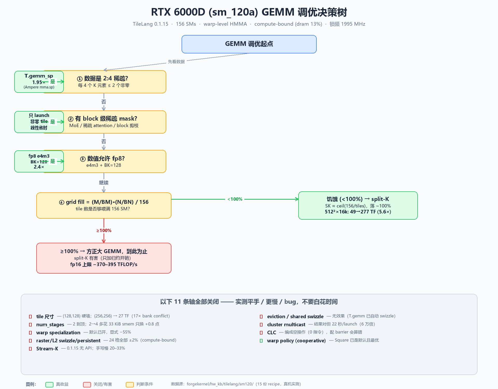
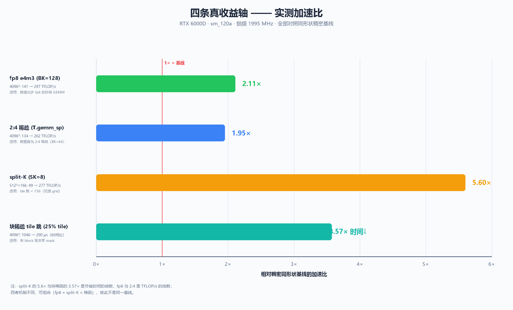

# RTX 6000D（sm_120a）GEMM 调优方案

> 本文档是 15 条优化轴的完整实测结论汇总，数据来自真机 RTX 6000D，SM 频率锁 1995 MHz，
> TileLang 0.1.15，目标 `sm_120a`。每条轴的详细数据见 `forgekernel/hw_kb/tilelang/sm120/`
> 下对应的 recipe 文件（文末有映射表）。
>
> 一句话结论：**15 条轴里只有 4 条真收益（fp8 2.4×、split-K 最高 5.6×、2:4 稀疏 1.95×、
> 块稀疏线性省时），其余要么已是默认最优，要么平手，要么更慢/bug。** 方正大 GEMM 已到
> 该 tile 几何的上限，进一步要靠换 dtype / 用稀疏 / 换 kernel 类别。





---

## 1. 硬件与环境

| 项 | 值 |
|---|---|
| GPU | NVIDIA RTX 6000D ×2（单卡测试） |
| 架构 | `sm_120`（Blackwell 工作站），**必须用 `sm_120a` 目标** |
| SM 数 | 156 |
| 共享内存 | `shared_memory_per_block_optin = 101376` B（99 KiB） |
| Tensor 路径 | **warp-level `HMMA`**（非 wgmma，非 tcgen05） |
| 驱动 / CUDA | 610.43.02 / CUDA 13.3 |
| TileLang | 0.1.15 |
| 频率 | 锁 2000（实测 1995 MHz）；未锁时 180–292 MHz 空闲、2430 boost |
| Python | 3.14（venv 在 `~/tlvenv`），torch 2.15.0+cu132 |

**目标必须是 `sm_120a`**：
- `sm_120` 能 lower 但 `nvcc` 拒绝（`warpgroup_reg_dealloc requires ... sm_90a`）；
- `sm_100a` 能编译但加载失败（`NO_BINARY_FOR_GPU`）。

**计时方法**（关键）：同一 kernel 三种测法给三个答案 —
单次 event 中位 122、NCU `gpu__time_duration` 265（L2 全热理想）、**CUDA-graph replay 137（持续稳态）**。
**调优用 graph replay；NCU 只用来问"为什么"；必须锁频**，否则 ±30% 噪声会反转结论。

---

## 2. 15 条轴总表

| # | 轴 | 结论 | 典型读数 | KB 文件 |
|---|---|---|---|---|
| 1 | **dtype** | ✅ **2.4×** | f16 141 → fp8 e4m3 297 TFLOP/s（BK 32→128） | `gemm_dtype_throughput.md` |
| 2 | **split-K** | ✅ **最高 5.6×**（仅饥饿 grid） | 512²×16k: 49 → 277 TFLOP/s (SK=8) | `split_k_fills_a_starved_grid.md` |
| 3 | **2:4 稀疏** | ✅ **1.95×**（数据真稀疏时） | 4096³: 262 vs 134 TF（`T.gemm_sp` → Ampere `mma.sp`） | `sparse_gemm_two_mechanisms.md` |
| 4 | **块稀疏 tile 跳** | ✅ **线性省时** | 25/50/75% tile → 0.28/0.54/0.70× 时间 | `sparse_gemm_two_mechanisms.md` |
| 5 | tile 尺寸 (BM/BN) | ❌ 有硬墙 | `(128,128)` 最优；`(256,256)` → 27 TF（17× bank conflict） | `tiled_copy_scope_and_swizzle.md` |
| 6 | `num_stages` | ❌ 平台 | 2→4 多花 33 KiB smem，只换 +0.8 点 `tensor_pct` | `software_pipeline_stage_budget.md` |
| 7 | warp specialization | ❌ 默认已开 | 显式 `role_based` 慢 2–8×（fp8 381→170，f16 157→20） | `warp_specialization_is_already_on.md` |
| 8 | block 调度 (raster/L2 swizzle/persistent) | ❌ 平手 | 24 格全部 ±2% | `block_scheduling_is_a_tie.md` |
| 9 | Stream-K | ❌ 无 API + 更慢 | 0.1.15 无 `streamk`；手写比 split-K 慢 20–33% | `stream_k_is_absent_and_loses.md` |
| 10 | eviction policy | ❌ 无效果 | 三档在 ±8% 噪声内（compute-bound） | `gemm_operand_layout_and_policy.md` |
| 11 | shared layout swizzle | ❌ 无效果 | `T.gemm` 已自动 swizzle | `tiled_copy_scope_and_swizzle.md` |
| 12 | warp policy (cooperative) | ✅ 已是默认 | `Square` 默认且少读 25% smem wavefront | `gemm_operand_layout_and_policy.md` |
| 13 | Cluster 发射 | ⚠️ 免费 | `T.ClusterKernel` 与 plain 平手 | `clusters_free_multicast_broken.md` |
| 14 | Cluster TMA multicast | ❌ bug | `copy_cluster` 22 秒 vs 0.35 ms（6 万倍慢，结果正确） | `clusters_free_multicast_broken.md` |
| 15 | CLC（Blackwell 动态调度） | ❌ 编成空操作 | SASS 里 0 条 CLC 指令；配合 barrier 会算错 | `clc_compiles_to_nothing.md` |

---

## 3. 四条真收益轴（详细）

### 3.1 dtype：fp8 = 2.4×（最稳的收益）

4096³，tile `(128,128,BK)`，stages=2：

| dtype | BK | TFLOP/s | 说明 |
|---|---|---|---|
| f16 | 32 | 141 | 基线 |
| bf16 | 32 | 144 | ≈ f16（都是 2 字节，数值选择非速度） |
| fp8 e4m3 | 32 | 269 | |
| fp8 e4m3 | 64 | 281 | |
| fp8 e4m3 | 128 | **297** | **最优（~2.1×）** |
| fp8 e5m2 | 64 | 306 | 略快但精度不同 |
| fp8 | 256 | 失败 | 128 KiB > 99 KiB smem 上限 |

- 全部 `cos=1.0`；fp8 `max_diff~1e-4` 只是 randn 分布友好，**真实激活必须用缩放 + cosine 校验**。
- **fp8 不开辟 tile 轴**：`(128,128,128)` 仍最优，BM/BN>128 同样崩（bank 几何属性，与元素宽度无关）。
- fp8 的收益不是来自 tile，而是来自每个 `mma` 处理更多字节。

### 3.2 split-K：最高 5.6×（仅饥饿 grid）

判据：**tile 数 = (M/BM)×(N/BN) 少于 156 SM 时**（填不满），split-K 把 block 数乘 SK：

| shape | tiles | 填充率 | plain | 最优 SK | TFLOP/s | 加速 |
|---|---|---|---|---|---|---|
| 512×512×16384 | 16 | 10% | 49 | SK=8 | 277 | **5.6×** |
| 768×768×8192 | 36 | 23% | 107 | SK=4 | 293 | 2.7× |
| 1024×1024×8192 | 64 | 41% | 190 | SK=2 | 323 | 1.7× |
| 2048×2048×8192 | 256 | 164% | 365 | — | — | plain 赢 |
| 4096³ | 1024 | 656% | 280 | — | — | plain 赢 |

- **最优 SK ≈ ceil(156 / tiles)**，把填充拉到约 100%（一波）；过冲即反降（SK=16 掉）。
- **满 grid 用 split-K 有害**（只是加归约开销）。
- 实现：`T.Kernel(nt, mt, SK)`，每块算 K 分片，`T.atomic_add(C_slice, acc)` 到 fp32 C。
  TileLang 无原生 `T.SplitK`，手写。
- **致命坑**：`out_idx=[2]` 只在第一次清零 C，`atomic_add` 从第二次起叠加上次结果
  （run1 md=3e-4，run2 md=6e2，cos 1.0→0.5）。**累加型 kernel 每次必须自己零 C。**

### 3.3 2:4 稀疏：1.95×（数据真稀疏时）

`T.gemm_sp(A_sparse, E, B, C)`，sm120 上 emit 的是 **Ampere `mma.sp`**（`SM80::MMA::SparseSel`），
不是 wgmma/tcgen05——正是这块 HMMA-only 卡能跑的。

契约：`A_sparse (M, K/2) f16`，`E (M, K/8) uint8`，逻辑 `K=2×A[-1]`，维度必须静态。

| shape | tile | 稀疏 | 稠密 f16 | 加速 |
|---|---|---|---|---|
| 4096³ | 128×128×64 | 262 TF | 134 TF | **1.95×** |
| 2048²×8192 | 128×128×64 | 229 TF | 118 TF | 1.94× |

- **是 1.95× 不是 2×**（epilogue 和稠密 B 喂数不减半）。
- **BK 必须 64**：E buffer 让 BK=128 撞 100 KiB smem 上限。
- **metadata E 不宽容**：`E=0x00`（保留每组前两个）→ cos 1.0；`0x88/0x11/0x22/0x55` → cos 0.5；
  `0xAA/0xFF` → cos 0。全部编译运行，只有一个对。
- **注意**：稠密 fp8（300–380 TF）已比 f16-2:4-稀疏（262 TF）快，稀疏不是自动最快；sparse+fp8 可叠加。

### 3.4 块稀疏 tile 跳：线性省时

只 launch 非零 output tile，从压缩 int32 索引表解码 `(m,n)`：

| 非零 tile | 时间 | vs dense | 匹配 |
|---|---|---|---|
| 100% | 1046 µs | 1.00× | 基线 |
| 75% | 729 µs | 0.70× | ✓ 逐位一致 |
| 50% | 570 µs | 0.54× | ✓ |
| 25% | 290 µs | 0.28× | ✓ |

纯 grid shaping，可与 dtype / split-K / tile 全部组合。代价是每 block 一次 `int2` 载入。

---

## 4. 决策树

```
GEMM 调优起点
│
├─ 数据是否 2:4 稀疏？
│   └─ 是 → T.gemm_sp（1.95×，BK=64，正确构造 E）
│
├─ 是否有 block 级稀疏 mask（MoE / 稀疏 attention / block pruning）？
│   └─ 是 → 只 launch 非零 tile（线性省时）
│
├─ dtype：数值允许 fp8？
│   └─ 是 → fp8 e4m3 + BK=128（2.4×，本卡最大单项收益）
│
├─ grid fill = (M/BM)×(N/BN) / 156
│   ├─ < 100%（饥饿，如 512²×16k / LM head / decode）
│   │    → split-K，SK ≈ ceil(156/tiles)，落在 ~100% 不要太满
│   └─ ≥ 100%（方正大 GEMM）
│        → 不要再 split-K；到此为止
│
└─ 其余全部关闭：
     tile 就 (128,128)，stages=2，不要 WS，不要 L2 swizzle/persistent，
     不要 eviction hint，不要 cluster multicast，不要 CLC，不要手写 Stream-K。
     约 370–395 TFLOP/s（fp16）是该 tile 几何的上限。
```

---

## 5. 推荐基础 kernel（未加 split-K/稀疏）

```python
import tilelang
import tilelang.language as T

M = N = K = 4096
BM = BN = BK = 128                 # (128,128) 是硬上限；fp8 用 BK=128
DT = "float8_e4m3"


@T.prim_func
def gemm(A: T.Tensor((M, K), DT), B: T.Tensor((K, N), DT), C: T.Tensor((M, N), "float16")):
    with T.Kernel(T.ceildiv(N, BN), T.ceildiv(M, BM), threads=256) as (bx, by):
        a_s = T.alloc_shared((BM, BK), DT)
        b_s = T.alloc_shared((BK, BN), DT)
        acc = T.alloc_fragment((BM, BN), "float32")
        T.clear(acc)
        for k in T.Pipelined(T.ceildiv(K, BK), num_stages=2):
            T.copy(A[by * BM, k * BK], a_s)
            T.copy(B[k * BK, bx * BN], b_s)
            T.gemm(a_s, b_s, acc)
        T.copy(acc, C[by * BM, bx * BN])


kernel = tilelang.compile(gemm, out_idx=[2], target={"kind": "cuda", "arch": "sm_120a"})
# ~370–395 TFLOP/s。加 WS / swizzle / persistent / cluster / 更大 tile / 更多 stages
# 全部打平或更差。只有 fp8、split-K（饥饿时）、稀疏是改进。
```

---

## 6. 三个最坑的地方（都真实踩过）

1. **`out_idx` + `atomic_add` = 第二次起算错。** 输出只在第一次 launch 清零，split-K 随后
   叠加到上次结果（`md 3e-4 → 6e2`，`cos 1.0 → 0.5`）。累加型 kernel 每次自己零 C。
   这是整个项目最耗调试时间的问题。
2. **multicast 结果正确但慢 6 万倍。** `md` 与 plain 完全一致，只查正确性会发布 22 秒的 kernel。
   永远要计时。
3. **三种计时法三个答案。** 调优用 graph replay；NCU 只用来问为什么；不锁频会把 ±30% 噪声当信号。

---

## 7. 架构事实（反直觉但关键）

- **`sm_120` 能 lower 但编不过，`sm_100a` 能编但加载不了**，只有 `sm_120a` 能跑。compile/load
  失败第一件查这个。
- **数学是 warp-level `HMMA`**，不是 wgmma/tcgen05。这解释了为什么：
  - warp specialization 在这里是**减少**数学 warp（默认 pipeline 已把 TMA producer 分出去，
    再拆一层 −55%）；
  - cluster 的 2-SM MMA 无处可挂（只有 multicast，而它在本卡是坏的）；
  - CLC 的 `static_assert(dependent_false)` 回退成空操作。
- **`T.Pipelined` 本身就追加 producer warpgroup**（`threads=256` → `__launch_bounds__(384)`）；
  `threads=` 是 **consumer** 数，不是 launch 数。
- **本卡 compute-bound**（`tensor_pct ≈ 72%`，`dram_pct ≈ 13%`）。因此凡只重排/减少 DRAM/cache
  流量的轴（调度、swizzle、eviction）必然平手；只有**降低数学成本（dtype / 稀疏）**或
  **填满空闲 SM（split-K）**能真赢。

---

## 8. buf bug / 缺失清单（0.1.15 实测）

| 项 | 状态 | 后果 |
|---|---|---|
| Stream-K | 无 `streamk` 符号，`T.Kernel` 无 `streamk_programs` | `TypeError`；手写比 split-K 慢 20–33% |
| CLC | `clc_try_cancel` 编成 `static_assert(dependent_false)` 空操作 | SASS 0 条指令；配 barrier 会算错 |
| Cluster multicast | CTA-local barrier，未支持 cluster 回压（源码 TODO） | 结果对但 22 秒/launch |
| `sm_120` / `sm_100a` 目标 | 分别编不过 / 加载失败 | 必须 `sm_120a` |

版本升级后值得复测：CLC 只差一个 `CUTLASS_ARCH_CLC_ENABLED` 宏（arch 列表已含 SM120A）；
multicast 只差 cluster-scope barrier。

---

## 9. KB 文件映射

所有数据与论证在 `forgekernel/hw_kb/tilelang/sm120/`（已提交，`main` 分支）：

| 文件 | 内容 |
|---|---|
| `gemm_tuning_summary.md` | 一页决策总表（本文档的英文浓缩版） |
| `gemm_dtype_throughput.md` | f16/bf16/fp8 全面扫描 |
| `split_k_fills_a_starved_grid.md` | split-K 完整数据 + out_idx 坑 |
| `stream_k_is_absent_and_loses.md` | Stream-K 缺失 + 手写对比 |
| `sparse_gemm_two_mechanisms.md` | 2:4 `gemm_sp` + 块稀疏 tile 跳 |
| `tiled_copy_scope_and_swizzle.md` | tile 尺寸墙、bank conflict、shared layout swizzle |
| `software_pipeline_stage_budget.md` | stages 平台、`sm_120a` 目标门 |
| `warp_specialization_is_already_on.md` | WS 默认已开、显式更慢 |
| `block_scheduling_is_a_tie.md` | raster / L2 swizzle / persistent 平手 |
| `gemm_operand_layout_and_policy.md` | `mma.sync`、warp policy、eviction |
| `clusters_free_multicast_broken.md` | cluster 发射免费、multicast 坏 |
| `clc_compiles_to_nothing.md` | CLC 空操作、cooperative 已是默认 |
| `gpu_probe_ladder.md` | 测量协议、SASS census、三种计时法 |
| `index.md` | 索引 + 症状→recipe 对照表 |

---

## 10. 下一步方向

GEMM 已调满。剩余值得做的：

1. **FlashAttention / MLA**：split-K 的 grid-shaping 和 fp8 结论直接可迁移；softmax 的减法与
   online rescale 是唯一能开出**新 compute/bandwidth 平衡**的地方（非 compute-bound，调度轴
   可能重新有效）。
2. **LM head / decode 的 skinny GEMM**：正是 split-K 与块稀疏的主场。
3. **复测被版本阻塞的轴**：CLC、cluster multicast（升级 TileLang 后）。
